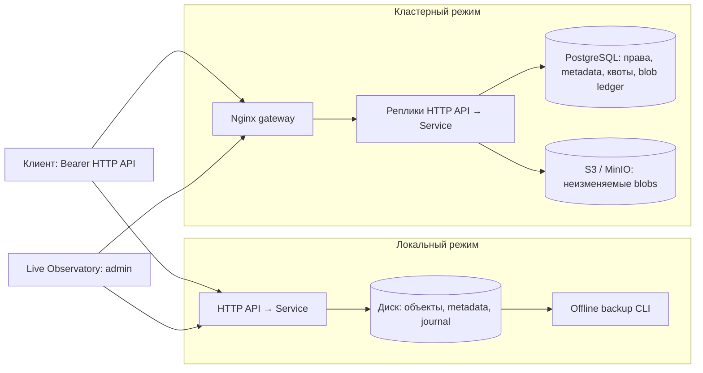

# Triple-S

Triple-S — HTTP-сервис хранения файлов на Go: бакеты, объекты, пользовательские пространства и совместный доступ. Два backend: локальный диск с восстановлением после сбоев и кластер реплик API с общими PostgreSQL и S3/MinIO.

**Внешний API не полностью совместим с Amazon S3:** он использует Bearer-токены и собственные XML-ответы. AWS Signature V4, клиентский multipart API и presigned URLs не реализованы. AWS SDK используется внутри кластерного backend для обращения к S3; прямую совместимость API Triple-S с AWS CLI проект не предоставляет.

## Содержание

- [Возможности и технологии](#возможности-и-технологии)
- [Архитектура](#архитектура)
- [Структура проекта](#структура-проекта)
- [Требования](#требования)
- [Первоначальная настройка доступа](#первоначальная-настройка-доступа)
- [Локальный запуск без Docker](#локальный-запуск-без-docker)
- [Кластер через Docker Compose](#кластер-через-docker-compose)
- [Кластер без Docker](#кластер-без-docker)
- [Конфигурация](#конфигурация)
- [Пользователи и права](#пользователи-и-права)
- [База данных и миграции](#база-данных-и-миграции)
- [HTTP API](#http-api)
- [Наблюдение за сервером](#наблюдение-за-сервером)
- [Резервные копии и обслуживание](#резервные-копии-и-обслуживание)
- [Сборка и проверки](#сборка-и-проверки)
- [CI/CD](#cicd)
- [Разработка и ограничения](#разработка-и-ограничения)
- [Troubleshooting](#troubleshooting)
- [Дополнительная документация](#дополнительная-документация)

## Возможности и технологии

- Создание и удаление пустых бакетов; PUT, GET, HEAD, DELETE объектов.
- Listing с `prefix`, `after`, `limit`; квоты логических байтов и количества объектов на пространство.
- Потоковое скачивание, HTTP Range и conditional requests, SHA-256/ETag, определение MIME по содержимому.
- Пользователи, администраторы, grants `read`/`write` на отдельные бакеты.
- Local: блокировка второго процесса, durable journal, восстановимые metadata, проверяемый offline backup.
- Cluster: общие права и квоты в PostgreSQL, неизменяемые blobs в S3, реплики API за Nginx, отложенный GC.
- JSON-логи, `X-Request-ID`, Prometheus metrics, встроенная панель Live Observatory.

| Компонент                 | Технология                                                                 |
| ------------------------- | -------------------------------------------------------------------------- |
| Сервер и CLI              | Go: `go 1.25.0`, toolchain `go1.25.12`; `net/http`, `log/slog`             |
| Внешнее object storage    | AWS SDK for Go v2: core `v1.47.5`, S3 `v1.114.6`, transfermanager `v0.5.1` |
| Metadata и права кластера | PostgreSQL, `pgx/v5 v5.11.0`; Compose использует PostgreSQL 16             |
| Локальный S3-стенд        | MinIO, source build `RELEASE.2025-10-15T17-29-55Z`                         |
| Балансировка              | Nginx `1.28-alpine` в Compose                                              |
| Контейнер приложения      | Go builder; Alpine 3.22, CA certificates, непривилегированный пользователь |
| Панель                    | Встроенные HTML/CSS/JavaScript, без Node.js и CDN во время работы          |

Redis, Kafka и другие брокеры не требуются. Prometheus/Grafana в Compose не включены; есть пример scrape-конфигурации.

## Архитектура

`main.go` собирает конфигурацию, backend, сервис, HTTP API и мониторинг. Обработчики работают через интерфейс операций; сервис проверяет доменные параметры и вызывает repository. Общие модели, валидация и ошибки находятся в `internal/objectstore`.



**Local.** Один процесс владеет каталогом через файловую блокировку. Загрузка сначала сохраняется во временный файл с вычислением SHA-256. Журнал фиксирует решение PUT/DELETE до окончательной публикации данных и metadata. Ошибка завершения принятого решения блокирует доступ с `503` до перезапуска и recovery. При старте восстанавливаются metadata и индекс; это может потребовать чтения объектов.

**Cluster.** Upload проходит через локальный staging, затем S3 с новым внутренним ключом. Транзакция PostgreSQL публикует ссылку на blob, metadata и изменения квоты. Команда `gc` удаляет старые/незавершённые blobs после удержания не менее 48 часов. Реплики API не реплицируют файлы друг другу: HA самих PostgreSQL и S3 обеспечивается отдельно.

Файл не требуется целиком держать в RAM, но staging требует свободного диска. Внутренний S3 transfer manager использует multipart: порог и размер части 8 MiB, параллелизм 2. Это не клиентский multipart API.

Compose содержит один PostgreSQL и один MinIO: это dev-стенд, не HA-инфраструктура. Nginx разрешает реплики через Docker DNS, использует passive upstream failure handling; автоматический повтор запроса отключён. Readiness API проверяется отдельно контейнерным healthcheck.

## Структура проекта

```text
.
├── main.go, observatory.go       # HTTP-сервер и фоновый мониторинг
├── cmd/
│   ├── triple-s-backup/          # create / verify / restore локальных данных
│   └── triple-s-cluster/         # инициализация и обслуживание кластера
├── internal/
│   ├── access/                  # пользователи, токены, grants
│   ├── backup/                  # архивы, manifest, проверка восстановления
│   ├── cluster/                 # PostgreSQL + S3, SQL-схемы, GC, импорт
│   ├── config/                  # параметры запуска
│   ├── httpapi/                 # XML API, авторизация, метрики, панель
│   ├── objectstore/             # модели, ошибки, валидация
│   ├── observatory/             # состояние и события live-мониторинга
│   ├── service/                 # слой операций хранения
│   └── storage/                 # файлы, metadata, journal, recovery
├── deploy/
│   ├── cluster/                 # Compose, Nginx, MinIO build, IAM/SQL примеры
│   └── prometheus.example.yml
├── docs/                        # устройство и эксплуатация подсистем
├── tests/                       # все тесты, overlay runner, mocks и simulations
├── .github/workflows/ci.yml      # build, vet, tests, race, cluster tests
├── Dockerfile, .dockerignore
└── go.mod, go.sum
```

## Требования

- Для исходников: Go 1.25.12 и доступ к Go modules. Все команды выполняются из корня проекта.
- Для local: Linux или macOS, файловая система с поддержкой используемых блокировок и синхронизации. Windows не поддерживается локальным backend.
- Для Compose: Docker Engine/Desktop и Docker Compose v2; первая сборка MinIO скачивает исходники и зависимости.
- Для cluster без контейнеров: PostgreSQL и S3/MinIO, заранее созданный физический bucket, SQL/S3-права оператора.
- Python 3 для генератора конфигурации ниже; `curl` для примеров API; `tar` для тестов legacy backup. Race detector требует поддерживаемого CGO toolchain.
- Место под данные, staging и backup. В Compose `/tmp` каждой реплики API ограничен 1 GiB.

## Первоначальная настройка доступа

Пример создаёт **новую dev-конфигурацию вне репозитория**: исходный токен администратора, registry с его SHA-256 и environment Compose. Значения секретов не выводятся. Если файлы уже существуют, используйте их: генератор откажется перезаписывать конфигурацию.

```sh
export TRIPLE_S_CONFIG_DIR="${XDG_CONFIG_HOME:-$HOME/.config}/triple-s"
python3 - "$TRIPLE_S_CONFIG_DIR" <<'PY'
import hashlib, json, os, pathlib, secrets, sys
p = pathlib.Path(sys.argv[1]).expanduser().absolute()
p.mkdir(mode=0o700, parents=True, exist_ok=True)
names = ("operator.token", "users.json", "cluster.env")
if any((p / name).exists() for name in names):
    raise SystemExit("Конфигурация уже существует: используйте её без перезаписи")
os.chmod(p, 0o700)
token = secrets.token_hex(32)
registry = {"version": 1, "users": [{"id": "operator", "role": "admin",
    "token_sha256": hashlib.sha256(token.encode()).hexdigest()}]}
env = {"POSTGRES_PASSWORD": secrets.token_hex(24),
       "MINIO_ROOT_USER": "triples-dev", "MINIO_ROOT_PASSWORD": secrets.token_hex(32),
       "TRIPLE_S_USERS_FILE": str(p / "users.json"),
       "LOCAL_UID": str(os.getuid()), "LOCAL_GID": str(os.getgid())}
files = {"operator.token": token + "\n",
         "users.json": json.dumps(registry, indent=2) + "\n",
         "cluster.env": "".join(k + "=" + json.dumps(v) + "\n" for k, v in env.items())}
for name, content in files.items():
    fd = os.open(p / name, os.O_WRONLY | os.O_CREAT | os.O_EXCL, 0o600)
    with os.fdopen(fd, "w") as f:
        f.write(content)
print("Конфигурация создана в", p)
PY
```

`TRIPLE_S_CONFIG_DIR` — переменная примеров, приложение её не читает. В новом терминале задайте её снова. Не добавляйте созданные файлы в Git. Изменение `cluster.env` не меняет пароль уже созданного PostgreSQL volume.

## Локальный запуск без Docker

```sh
go mod download
unset TRIPLE_S_TOKEN
go run . --dir ./data --users-file "$TRIPLE_S_CONFIG_DIR/users.json"
```

API: `http://127.0.0.1:8080`. Каталог `data` создаётся автоматически. Остановка — `Ctrl+C`; SIGINT/SIGTERM запускают graceful shutdown.

Альтернатива registry — `TRIPLE_S_TOKEN`: один административный токен длиной не менее 32 байт без пробельных символов. Он даёт доступ ко всем пространствам. Не задавайте один токен одновременно в environment и registry.

TLS: `--tls-cert /path/server.crt --tls-key /path/server.key`. Внешний bind без TLS требует явного `--allow-insecure-http`; используйте его только в доверенной сети или за TLS-терминацией. `--host` принимает IP, не DNS-имя.

## Кластер через Docker Compose

Используйте конфигурацию из предыдущих разделов. Команды выполняются из корня репозитория.

### Первый запуск нового стенда

```sh
docker compose --env-file "$TRIPLE_S_CONFIG_DIR/cluster.env" -f deploy/cluster/compose.yaml config --quiet
docker compose --env-file "$TRIPLE_S_CONFIG_DIR/cluster.env" -f deploy/cluster/compose.yaml up -d --build postgres minio
docker compose --env-file "$TRIPLE_S_CONFIG_DIR/cluster.env" -f deploy/cluster/compose.yaml run --rm --build admin provision-local
docker compose --env-file "$TRIPLE_S_CONFIG_DIR/cluster.env" -f deploy/cluster/compose.yaml run --rm admin init --users-file /run/users.json
docker compose --env-file "$TRIPLE_S_CONFIG_DIR/cluster.env" -f deploy/cluster/compose.yaml up -d --build --scale api=3 api gateway
curl -f http://127.0.0.1:8080/-/ready
```

`provision-local` создаёт dev bucket и задаёт cleanup незавершённых multipart через один день. Он **заменяет lifecycle bucket**, требует insecure-режим и явный endpoint; не используйте его в production. `init` создаёт SQL-схему, лимиты и пользователей. Повторный `init` существующего кластера — ошибка.

| Адрес                                 | Назначение                                                   |
| ------------------------------------- | ------------------------------------------------------------ |
| `http://127.0.0.1:8080`               | API через `gateway`                                          |
| `http://127.0.0.1:8080/-/observatory` | Панель                                                       |
| `http://127.0.0.1:9000`               | Физический S3 API MinIO, не API Triple-S                     |
| `http://127.0.0.1:9001`               | Консоль MinIO; credentials берутся из приватной конфигурации |

PostgreSQL доступен как `postgres:5432` внутри Compose; порт на хост не опубликован. База/пользователь — `triples`. Физический bucket — `triples-objects`, регион — `us-east-1`. Пользовательские бакеты Triple-S представлены metadata и внутренними ключами, а не отдельными физическими S3 buckets.

### Повторный запуск и остановка

Для существующих volumes пропустите `provision-local` и `init`:

```sh
docker compose --env-file "$TRIPLE_S_CONFIG_DIR/cluster.env" -f deploy/cluster/compose.yaml up -d --build --scale api=3
docker compose --env-file "$TRIPLE_S_CONFIG_DIR/cluster.env" -f deploy/cluster/compose.yaml ps
docker compose --env-file "$TRIPLE_S_CONFIG_DIR/cluster.env" -f deploy/cluster/compose.yaml logs --tail=100 api gateway
docker compose --env-file "$TRIPLE_S_CONFIG_DIR/cluster.env" -f deploy/cluster/compose.yaml down
```

`down` сохраняет volumes `postgres-data` и `minio-data`; добавление `--volumes` удаляет данные. Dockerfile собирает сервер и обе административные CLI; готового опубликованного образа проект не задаёт.

## Кластер без Docker

Оператор заранее подготавливает PostgreSQL и физический S3 bucket и приватно задаёт environment:

- `TRIPLE_S_DATABASE_URL`: PostgreSQL URI с `sslmode=verify-full` для защищённого подключения;
- `TRIPLE_S_S3_BUCKET`, `AWS_REGION`;
- AWS credentials через стандартную цепочку SDK: IAM role, профиль или environment;
- `TRIPLE_S_S3_ENDPOINT` для MinIO/другого endpoint, в production HTTPS;
- при необходимости `TRIPLE_S_TEMP_DIR` с достаточным свободным местом.

```sh
mkdir -p bin
go build -o bin/triple-s .
go build -o bin/triple-s-cluster ./cmd/triple-s-cluster
unset TRIPLE_S_TOKEN
# Только для новой подготовленной базы и физического bucket:
./bin/triple-s-cluster init --users-file "$TRIPLE_S_CONFIG_DIR/users.json"
./bin/triple-s --backend cluster
```

Для dev PostgreSQL без TLS и MinIO по HTTP есть `TRIPLE_S_CLUSTER_INSECURE=1`. Не переносите insecure-режим и MinIO root credentials в production.

Cluster-сервер отвергает `TRIPLE_S_TOKEN`, `--users-file`, явно заданные `--dir`, `--max-object-bytes`, `--max-storage-bytes`, `--max-objects`. Registry и лимиты берутся из PostgreSQL; начальные лимиты задаются флагами команды `init`.

## Конфигурация

Приложение не загружает `.env` автоматически; `--env-file` обрабатывает Compose.

| Флаг сервера              | По умолчанию        | Назначение                                           |
| ------------------------- | ------------------- | ---------------------------------------------------- |
| `--backend`               | `local`             | `local` или `cluster`                                |
| `--dir`                   | `data`              | Каталог local; преобразуется в абсолютный путь       |
| `--users-file`            | не задан            | Приватный registry local                             |
| `--host`, `--port`        | `127.0.0.1`, `8080` | IP и порт; порты 1024–49151                          |
| `--log-level`             | `info`              | Уровень JSON-логов                                   |
| `--max-object-bytes`      | `67108864`          | Максимум одного файла 64 MiB, local                  |
| `--max-storage-bytes`     | `0`                 | Логические байты на пространство; 0 без квоты, local |
| `--max-objects`           | `0`                 | Объекты на пространство; 0 без квоты, local          |
| `--max-uploads`           | `8`                 | Admission limit загрузок на процесс                  |
| `--max-downloads`         | `16`                | Admission limit скачиваний на процесс                |
| `--request-timeout`       | `2m`                | Контекст запроса                                     |
| `--shutdown-timeout`      | `30s`               | Graceful shutdown                                    |
| `--tls-cert`, `--tls-key` | не заданы           | Парные пути сертификата и ключа                      |
| `--allow-insecure-http`   | `false`             | Разрешить внешний HTTP без TLS                       |

| Переменная                                                                       | Назначение                                                                     |
| -------------------------------------------------------------------------------- | ------------------------------------------------------------------------------ |
| `TRIPLE_S_TOKEN`                                                                 | Административный токен local; не нужен при registry                            |
| `TRIPLE_S_DATABASE_URL`                                                          | Обязательный PostgreSQL URI кластера                                           |
| `TRIPLE_S_S3_BUCKET`, `AWS_REGION`                                               | Обязательные физический bucket и регион                                        |
| `TRIPLE_S_S3_ENDPOINT`                                                           | Необязательный S3-compatible endpoint                                          |
| `TRIPLE_S_TEMP_DIR`                                                              | Staging кластера; иначе системный temp                                         |
| `TRIPLE_S_CLUSTER_INSECURE`                                                      | Только `1` разрешает dev-подключения без требуемой защиты                      |
| `AWS_ACCESS_KEY_ID`, `AWS_SECRET_ACCESS_KEY`, `AWS_SESSION_TOKEN`, `AWS_PROFILE` | Варианты стандартной credential chain SDK; для production предпочтительны роли |
| `POSTGRES_PASSWORD`, `MINIO_ROOT_USER`, `MINIO_ROOT_PASSWORD`                    | Входные переменные Compose, не прямые параметры сервера                        |
| `TRIPLE_S_USERS_FILE`, `LOCAL_UID`, `LOCAL_GID`                                  | Mount registry и пользователь инструмента `admin` в Compose                    |

Пароль PostgreSQL в Compose вставляется в URI: используйте URI-безопасное значение, например сгенерированный hex. Registry должен быть обычным файлом без symlink с правами `0600`/`0400`, размером не более 1 MiB. Полный список флагов: `go run . --help`.

## Пользователи и права

Registry содержит `version: 1` и массив `users`. Поля пользователя: стабильный `id`, роль `admin`/`user`, `token_sha256`, при необходимости `grants`. ID: `[a-z][a-z0-9_-]{0,63}`; хеш: 64 lowercase hex-символа. Исходный токен в registry не хранится.

- Пользователь без scope работает в своём пространстве. Admin без `X-Storage-User` работает с прежним общим пространством, а не со своим ID.
- `X-Storage-User: owner-id` выбирает владельца; роль/grants определяют доступ.
- `read` разрешает чтение и listing выбранного бакета; `write` дополнительно PUT/overwrite/DELETE объектов, но не управление бакетом или просмотр usage владельца.
- Grants привязаны к имени бакета: повторное создание такого имени сохраняет grant. Отключение владельца само по себе не отзывает grants получателей.
- Local загружает registry при запуске. Cluster хранит авторитетный registry в PostgreSQL; обновлённые права действуют для следующих запросов.

Применить **полную замену**, не частичное добавление пользователей:

```sh
docker compose --env-file "$TRIPLE_S_CONFIG_DIR/cluster.env" -f deploy/cluster/compose.yaml run --rm admin sync-users --users-file /run/users.json
```

Сохраните активного администратора. Удаление пользователя не удаляет его данные. Схема grants и миграция: [multiuser-access.md](docs/multiuser-access.md).

## База данных и миграции

[schema.sql](internal/cluster/schema.sql) содержит настройки, пространства, пользователей, бакеты, объекты, blob ledger. [observatory.sql](internal/cluster/observatory.sql) — heartbeat реплик. API не выполняет DDL при старте.

`triple-s-cluster init` создаёт новый кластер в транзакции с advisory lock, фиксирует физический bucket/region/endpoint и S3 prefix. Лимиты `--max-object-bytes`, `--max-storage-bytes`, `--max-objects` задаются здесь. Последовательных миграций up/down и автоматического rollback в проекте нет.

Кластеру, созданному до Live Observatory, оператор с DDL-правами выполняет идемпотентную команду:

```sh
docker compose --env-file "$TRIPLE_S_CONFIG_DIR/cluster.env" -f deploy/cluster/compose.yaml run --rm admin enable-observatory
```

[database-roles.sql](deploy/cluster/database-roles.sql) и [iam-policy.example.json](deploy/cluster/iam-policy.example.json) — шаблоны разделения runtime/operator прав, требующие адаптации. Runtime не нужен DDL или физический `DeleteObject`; отдельному GC нужны права удаления. Compose использует более широкие dev-права.

## HTTP API

OpenAPI/Swagger-спецификации и Swagger UI в репозитории нет. Контракт реализован в `internal/httpapi` и HTTP-тестах. Требуется `Authorization: Bearer <token>`, кроме статических ресурсов панели и cluster readiness.

| Метод и путь                                       | Поведение                                                           |
| -------------------------------------------------- | ------------------------------------------------------------------- |
| `GET /`                                            | XML-список доступных бакетов выбранного пространства                |
| `PUT /{bucket}`                                    | Создать бакет, `200`                                                |
| `DELETE /{bucket}`                                 | Удалить пустой бакет, `200`; непустой — `409`                       |
| `GET`, `HEAD /{bucket}?prefix=…&after=…&limit=100` | XML listing; limit 1–1000, default 100; `NextAfter`/`IsTruncated`   |
| `PUT /{bucket}/{key}`                              | Raw body, создать/заменить объект, `200`; бакет должен существовать |
| `GET /{bucket}/{key}`                              | Файл, `200`/`206` для Range                                         |
| `HEAD /{bucket}/{key}`                             | Заголовки объекта без содержимого                                   |
| `GET`, `HEAD /{bucket}/{key}?metadata=1`           | XML-metadata вместо файла                                           |
| `DELETE /{bucket}/{key}`                           | `204`; отсутствующий объект — `404`                                 |
| `GET`, `HEAD /-/usage`                             | XML с байтами, объектами, бакетами и квотами владельца              |
| `GET`, `HEAD /-/metrics`                           | Prometheus, только admin                                            |
| `GET`, `HEAD /-/ready`                             | Только cluster: `200`/`503`, без токена и тела                      |
| `GET /-/observatory`                               | Статическая оболочка панели                                         |
| `GET`, `HEAD /-/observatory/state`                 | JSON-состояние панели, только admin                                 |

Bucket: 3–63 lowercase ASCII-символа, цифры, `.` и `-`, с дополнительными проверками DNS-подобного имени. Key: один UTF-8 сегмент до 255 байт без `/`, `\`, управляющих символов и служебных имён. Вложенные пути `images/photo.jpg` не поддерживаются.

Download возвращает `Content-Disposition: attachment`, MIME по содержимому, `X-Content-Type-Options: nosniff`, SHA-256 ETag и checksum. Range и conditional requests обрабатывает стандартный `ServeContent`. XML `ObjectKey` — историческое представление, не физический S3 key. MIME detection не является allowlist или антивирусом.

### Примеры запросов

Для конфигурации выше прочитайте исходный token без вывода в терминал. Admin без scope работает в прежнем общем пространстве:

```sh
API_URL=http://127.0.0.1:8080
TOKEN="$(cat "$TRIPLE_S_CONFIG_DIR/operator.token")"
curl -i -X PUT -H "Authorization: Bearer $TOKEN" "$API_URL/demo-bucket"
curl -i -X PUT -H "Authorization: Bearer $TOKEN" --data-binary @README.md "$API_URL/demo-bucket/readme.md"
curl -f -H "Authorization: Bearer $TOKEN" "$API_URL/demo-bucket?prefix=read&limit=10"
curl -f -H "Authorization: Bearer $TOKEN" "$API_URL/demo-bucket/readme.md?metadata=1"
curl -f -H "Authorization: Bearer $TOKEN" -o /tmp/triple-s-readme.download "$API_URL/demo-bucket/readme.md"
curl -I -H "Authorization: Bearer $TOKEN" "$API_URL/demo-bucket/readme.md"
curl -f -H "Authorization: Bearer $TOKEN" -H 'Range: bytes=0-63' "$API_URL/demo-bucket/readme.md"
curl -f -H "Authorization: Bearer $TOKEN" "$API_URL/-/usage"
# Очистка примера:
curl -i -X DELETE -H "Authorization: Bearer $TOKEN" "$API_URL/demo-bucket/readme.md"
curl -i -X DELETE -H "Authorization: Bearer $TOKEN" "$API_URL/demo-bucket"
unset TOKEN
```

Для своего пространства/общего бакета добавьте `-H 'X-Storage-User: owner-id'` с реальным ID владельца из registry.

Ориентируйтесь на HTTP-статус: некоторые успешные XML-ответы исторически используют envelope `Error` с кодом `200`. Ошибки: `400` параметры, `401` токен, `403` права, `404` объект/бакет, `409` конфликт/квота, `413` размер, `416` Range, `500` backend, `503` перегрузка/недоступное состояние. Admission limit даёт `Retry-After: 1`; timeout/оборванная загрузка могут дать `408`. Обрыв скачивания после отправки заголовков прекращает поток без дописывания XML в файл.

## Наблюдение за сервером

Откройте [Live Observatory](http://127.0.0.1:8080/-/observatory) и вставьте административный токен. На macOS скопировать без вывода:

```sh
pbcopy < "$TRIPLE_S_CONFIG_DIR/operator.token"
```

Токен остаётся в памяти страницы, не в query string или browser storage. Панель опрашивает state каждые 2 секунды. Cluster heartbeat хранится в PostgreSQL; запись старше 15 секунд устаревшая. Доступны текущие операции, скользящий RPS, средняя latency, соединения, usage, здоровье PostgreSQL/S3 и blob ledger.

Внутренняя репликация S3, backup и телеметрия Nginx не подключены. События ограничены по количеству, не заменяют аудит/tracing. Соединения включают idle TCP. Метрики реплики сбрасываются при перезапуске; Prometheus должен опрашивать каждую реплику, не случайный upstream. Пример: [prometheus.example.yml](deploy/prometheus.example.yml).

Логи JSON в stderr; raw URL, имена объектов, тело, токены и заголовки в telemetry не записываются. Контракты: [observability.md](docs/observability.md), [live-observatory.md](docs/live-observatory.md).

## Резервные копии и обслуживание

### Локальный backend

Остановите процесс с каталогом `data`: CLI блокирует активное хранилище. Назначение должно быть новым каталогом, его родитель должен существовать.

```sh
go build -o /tmp/triple-s-backup ./cmd/triple-s-backup
BACKUP_ROOT="${XDG_DATA_HOME:-$HOME/.local/share}/triple-s-backups"
mkdir -p "$BACKUP_ROOT"
BACKUP_PATH="$BACKUP_ROOT/backup-$(date +%Y%m%d-%H%M%S)"
/tmp/triple-s-backup create --dir ./data --out "$BACKUP_PATH"
/tmp/triple-s-backup verify --backup "$BACKUP_PATH"
/tmp/triple-s-backup restore --backup "$BACKUP_PATH" --to ./data-restored
```

Копия содержит все пространства, manifest и SHA-256. `create` выполняет пробное восстановление, `verify` повторяет проверку. Перед заменой рабочего каталога проверьте восстановленный. Users registry, исходные токены и TLS-ключи резервируются отдельно безопасным способом. Подробнее: [backup-restore.md](docs/backup-restore.md).

### Кластер

Локальный backup CLI не покрывает PostgreSQL/S3. Автоматизированного согласованного cluster backup/restore нет: оператор должен согласовать metadata snapshot с сохранением всех упомянутых blobs и проверить восстановление обоих хранилищ.

Команды с теми же environment и operator permissions, что у `init`:

```sh
# Остановите source local и записи в target перед импортом:
./bin/triple-s-cluster import-local --dir ./data
# Полная проверка опубликованных объектов и SHA-256: остановите writes и GC:
./bin/triple-s-cluster verify
# Ограниченная партия устаревших blobs, удержанных не менее 48 часов:
./bin/triple-s-cluster gc --limit 100
./bin/triple-s-cluster ready
```

Импорт не перезаписывает отличающиеся объекты; совпадающие по размеру/checksum пропускает. Неизвестных владельцев сначала добавьте в registry кластера. GC автоматически не запускается: расписание задаёт оператор. `verify` проверяет текущее хранилище, не backup.

## Сборка и проверки

Все тесты и fixtures находятся в [tests/](tests/README.md). Запускайте их через `go run ./tests`: runner использует стандартный Go overlay, сохраняя доступ к закрытым функциям исходных пакетов. Обычный `go test ./...` без overlay перенесённые тесты не обнаружит. Отдельные группы, полная матрица и ограничения IDE описаны в [tests/README.md](tests/README.md).

### Сборка, статический анализ и форматирование

```sh
go build ./...
mkdir -p bin
go build -o bin/triple-s .
go build -o bin/triple-s-backup ./cmd/triple-s-backup
go build -o bin/triple-s-cluster ./cmd/triple-s-cluster
go run ./tests vet ./...
gofmt -l .
# Применить форматирование при разработке:
gofmt -w .
```

Makefile, отдельного lint runner и golangci-lint конфигурации нет. Используются стандартные `go vet` и `gofmt`.

### Unit, integration, security, recovery и нагрузка

```sh
go run ./tests -count=1 -timeout=3m ./...
go run ./tests -race -tags=integration -count=1 -timeout=5m ./...
go run ./tests -race -tags=stress -run '^TestStress' -v -count=1 -timeout=5m .
go run ./tests ./internal/storage -run '^$' -bench . -benchmem
# Быстрая проверка с меньшим файлом; CI использует default:
TRIPLE_S_TEST_LARGE_MIB=16 go run ./tests -tags=stress -run '^TestStress' -count=1 -timeout=5m .
```

Unit tests покрывают валидацию, авторизацию/grants, HTTP, metadata/journal recovery и backup. Integration-тесты используют настоящий loopback HTTP, TLS, shutdown и обрывы. Stress: файл 128 MiB по умолчанию и конкурентные PUT/GET/DELETE с проверкой данных; это проверка корректности, не доказательство определённого RPS/SLO.

Benchmarks измеряют PUT, download, listing и metadata recovery. Для профилирования добавьте стандартные `go run ./tests -cpuprofile`/`-memprofile` и используйте `go tool pprof`; публичного HTTP pprof endpoint нет.

### Интеграция PostgreSQL + S3

```sh
# Предварительно задайте адреса изолированных тестовых PostgreSQL и MinIO:
export TRIPLE_S_TEST_DATABASE_URL
export TRIPLE_S_TEST_S3_ENDPOINT
go run ./tests -race -tags=clusterintegration -run '^TestCluster' -v -count=1 -timeout=5m .
```

Эти `export` не создают подключения: значения нужно задать заранее. Без обеих переменных часть тестов пропускается. `clusterFixture` в [cluster_integration_test.go](tests/_suites/cluster/cluster_integration_test.go) принимает только loopback endpoints, создаёт временные SQL schemas с последующим удалением и пишет в тестовый S3 bucket. Он использует фиксированные **тестовые** credentials из этого файла; MinIO настройте соответственно. Dev Compose со случайными credentials не подходит без отдельной настройки. Инфраструктура описана в [CI](.github/workflows/ci.yml) и [testing.md](docs/testing.md). Не используйте рабочие БД/buckets или реальные AWS credentials.

Для необязательной проверки ошибок SDK есть [Postman simulation](tests/simulations/s3-failure.sim.yaml) и [mock](tests/mocks/s3-errors/default.js): stand-in ошибок, без хранения файлов и IAM/SigV4. Endpoint задаётся `TRIPLE_S_TEST_S3_FAILURE_ENDPOINT`; без него тест пропускается. Команды и границы проверки: [horizontal-scaling.md](docs/horizontal-scaling.md).

## CI/CD

[GitHub Actions](.github/workflows/ci.yml) запускается на push, pull request и вручную:

- Ubuntu/macOS: Go 1.25.12, build, vet, unit/security/recovery/backup tests, integration с race detector, large-file/concurrent stress с race detector.
- Отдельный Ubuntu job: PostgreSQL 16, MinIO, две реплики, квоты, ACL, multipart и сбои публикации.
- Read-only repository permissions; checkout credentials не сохраняются; предыдущий прогон той же ветки отменяется.

**Известное расхождение:** cluster job скачивает `quay.io/minio/minio:RELEASE.2025-06-13T11-33-47Z`, а Compose уже собирает MinIO из исходников. Для Quay-образа ранее наблюдался `401 UNAUTHORIZED`; job может остановиться до тестов. README не исправляет workflow. Фактический статус удалённых GitHub Actions здесь не подтверждён.

Автоматического production deployment, публикации образов и применения production migrations в CI/CD нет.

## Разработка и ограничения

- Сохраняйте границы `httpapi → service → repository`, общие модели/ошибки — в `objectstore`; зависимости подключайте при сборке приложения.
- Изменения API сопровождайте HTTP regression tests; journal/metadata — recovery tests; общих квот и ACL — проверкой нескольких реплик.
- Перед сменой формата локальных данных делайте offline backup: старый бинарник может быть несовместим.
- Держите registry, токены и environment вне Git; не включайте shell tracing при работе с credentials. В production разделяйте runtime/operator SQL/IAM права и используйте TLS.
- Квоты не включают staging, retired blobs, версии S3 и физический объём. Нужны отдельные лимиты диска и lifecycle/GC.
- Timeout не доказывает, что PUT/DELETE не зафиксирован. Exactly-once/idempotency-key API отсутствует; учитывайте состояние перед повтором.
- Local рассчитан на один процесс. Для горизонтального запуска нужен cluster, не общий каталог нескольких процессов.
- Presigned/resumable API, versioning API, антивирус, deduplication, thumbnails и автоматический backup в отдельный S3 bucket не реализованы.
- Multipart и фоновые health checks создают дополнительные S3-запросы; измеренных production throughput/latency и метрик стоимости в репозитории нет.
- Действуют request timeout и ограниченный срок жизни cluster reader; неограниченное по времени скачивание не гарантируется.

## Troubleshooting

| Симптом                             | Проверка и действие                                                                                                                       |
| ----------------------------------- | ----------------------------------------------------------------------------------------------------------------------------------------- |
| API `401`                           | Нужен исходный токен, не SHA-256. Проверьте активного пользователя; после правок registry перезапустите local или выполните `sync-users`. |
| `403` / не видны файлы              | Проверьте `X-Storage-User`, роль/grants. Admin без scope видит прежнее общее пространство.                                                |
| Неприватный users file              | Обычный файл `0600`/`0400`, без symlink; проверьте UID/GID контейнера `admin`.                                                            |
| Cluster отвергает флаги             | Уберите `TRIPLE_S_TOKEN`, `--users-file` и local-only флаги; registry/лимиты берутся из PostgreSQL.                                       |
| Local `503` после сбоя фиксации     | Сохраните данные/логи, устраните проблему диска, перезапустите для recovery. Не удаляйте journal вручную.                                 |
| `503`, `Retry-After: 1`             | Admission limit: уменьшите клиентскую конкуренцию и повторяйте с задержкой.                                                               |
| `409` / `413`                       | Проверьте квоты, размер файла, существование/содержимое бакета.                                                                           |
| Local `/-/ready` даёт `404`         | Endpoint предназначен для cluster; local проверяйте авторизованным API.                                                                   |
| Панель без данных                   | Введите admin token, проверьте state; старому кластеру нужна `enable-observatory` с DDL-правами.                                          |
| PostgreSQL auth после изменения env | Пароль существующего volume не меняется от правки env: восстановите конфигурацию или измените пароль штатно в БД.                         |
| MinIO Quay `401 UNAUTHORIZED`       | Текущий Compose использует source build: запускайте с `--build`. Старый образ остаётся в CI; это не ошибка Bearer token.                  |
| Bind/port error                     | Проверьте занятый 8080, IP `--host`, диапазон портов и TLS для внешнего bind.                                                             |
| Upload падает при свободной квоте   | Проверьте staging и `/tmp`: Compose ограничивает его 1 GiB на реплику.                                                                    |
| Ошибки защиты подключения           | Проверьте PostgreSQL `sslmode=verify-full`, CA и HTTPS S3; insecure разрешайте только в dev.                                              |
| Integration-тесты skipped           | Проверьте build tag, обе `TRIPLE_S_TEST_*` переменные, loopback; fault test требует failure endpoint.                                     |

## Дополнительная документация

Документы описывают последовательные этапы разработки и могут содержать ранние ограничения. Актуальные режимы запуска сведены выше; детали протоколов:

- [Архитектура](docs/architecture.md)
- [Тестирование](docs/testing.md)
- [Локальный backup/restore](docs/backup-restore.md)
- [Восстановимые metadata](docs/recoverable-metadata.md)
- [Фиксация PUT/DELETE](docs/object-commit.md)
- [Многопользовательский доступ](docs/multiuser-access.md)
- [Горизонтальное масштабирование](docs/horizontal-scaling.md)
- [Метрики и логи](docs/observability.md)
- [Live Observatory](docs/live-observatory.md)
- [Listing и квоты](docs/additional-features.md)
